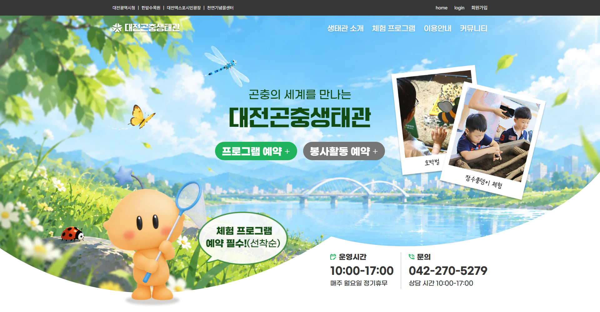
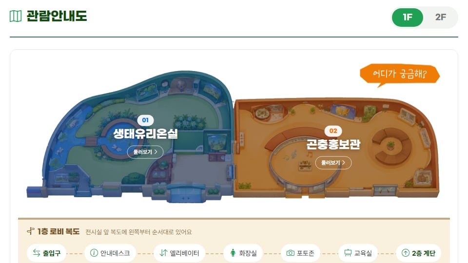
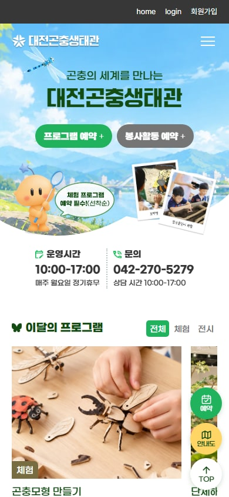
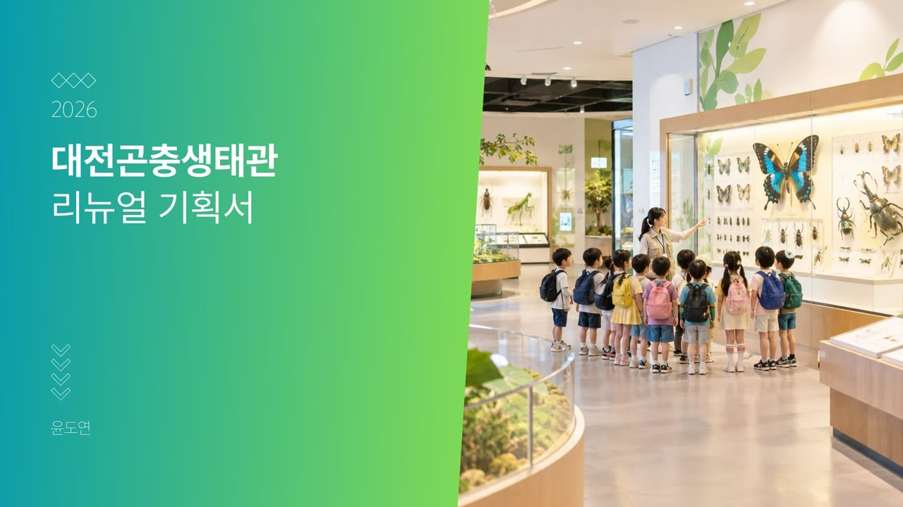

# 대전곤충생태관 — 홈페이지 리뉴얼

>대전곤충생태관 홈페이지를 가족단위 방문객이 쉽게 둘러보고 예약할 수 있도록 새롭게 디자인한 반응형 웹사이트입니다.

<br>

## 📌 프로젝트 개요

| 항목 | 내용 |
|---|---|
| 프로젝트 구분 | 개인용 포트폴리오 |
| 프로젝트 종류 | 공공기관 홈페이지 리뉴얼 (메인 + 서브 페이지 16개 반응형 구현) |
| 작업자 | 윤도연 (기여도 100%) |
| 사용 툴 | Figma, Photoshop, Visual Studio Code (HTML · CSS · JavaScript), Claude Code |
| 작업 기간 | 2026년 10월 19일 ~ 10월 23일 / 작업 기간 5일 (일 평균 4시간, 총 20시간) |

**🔗 사이트 보기: https://daejeon-insect-center.vercel.app**

<br>



<table>
  <tr>
    <td width="66%"></td>
    <td width="34%"></td>
  </tr>
  <tr>
    <td align="center">PC · 관람안내도</td>
    <td align="center">모바일 · 메인 첫 화면</td>
  </tr>
</table>

> **안내** — 이 저장소는 대전곤충생태관·대전광역시와 관련 없는 **개인 포트폴리오**입니다.
> 기관 명칭·로고·사진의 권리는 각 권리자에게 있으며, 화면 속 프로그램·예약 정보는 실제와 다를 수 있습니다.
> 실제 관람·예약 정보는 [대전곤충생태관 공식 홈페이지](https://www.daejeon.go.kr/ist/index.do)에서 확인해 주세요.

<br>

## 📝 기획서

페이지의 기획 의도와 작업 과정은 기획서에 정리했습니다.<br>
👇 $\color{red}{\textbf{이미지를 누르면 기획서가 열립니다.}}$

<a href="https://canva.link/r58p72il561jnwe"></a>

<br>

## 🎨 디자인 시스템

모든 색과 글자 크기는 `css/common.css` 맨 위 `:root`에 토큰으로 정리했습니다.

**컬러 — 숲의 초록 + 포인트 노랑**

| 토큰 | 값 | 쓰임 |
|---|---|---|
| `--버튼그린` | `#20b25d` | 주요 버튼, 선택 상태, 강조 |
| `--제목큰글씨그린` | `#134c13` | 섹션 제목, 큰 글씨 |
| `--선` | `#407860` | 구분선, 보조 강조, 사이드 메뉴 |
| `--포인트블루` | `#4972ca` | 키보드 포커스 표시 |
| `--운영-시간문의오시는-길-내용` | `#363636` | 본문 글자 |
| `--작은-글씨버튼그레이` | `#757575` | 작은 글씨, 비활성 버튼 |
| `--헤더푸터` | `#373737` | 상단 링크 줄, 푸터 바탕 |
| (포인트) | `#fff477` · `#ffd666` | 접수중 배지 · 안내도 퀵버튼, 버튼 호버 |

**타이포그래피 — Pretendard (본문) · Gmarket Sans (제목·라벨) · MBC 1961 고딕 (메인 타이틀)**

- 글꼴은 `--font-base`, `--font-gmarket`, `--font-mbc` 세 개의 토큰으로 지정합니다.
- 글자 크기는 시안(1920px)에서 쓴 단계를 토큰으로 정리했습니다: `--banner`(60) · `--h2`(38) · `--h3`(30) · `--h4`(27) · `--notice_text`(25) · `--text`(23) …
- 토큰 이름은 **Figma 스타일 이름을 그대로** 가져와, 디자인 파일과 코드에서 같은 이름으로 찾을 수 있게 했습니다.

<br>

## 🛠️ 기술 스택 · 폴더 구조

**스택** — 빌드 도구 없는 순수 HTML · CSS · JavaScript / Swiper 11 (프로그램 슬라이더) / 카카오 지도 API / Pretendard · Gmarket Sans · MBC 1961 고딕 폰트 / Bootstrap Icons / Vercel 배포

```
├── index.html                 메인 페이지
├── about.html, history.html, organization.html, industry.html
│                              생태관 소개 (곤충생태관은? · 연혁 · 조직 · 곤충산업육성)
├── program_Information.html   프로그램 안내 목록
├── program_detail.html        프로그램 상세 (?id= 로 모든 프로그램을 한 템플릿에서)
├── program_reservation.html   프로그램 예약
├── volunteer.html             자원봉사 신청
├── guide.html, rules.html, location.html
│                              이용안내 (관람안내도 · 유의사항 · 찾아오시는 길)
├── notice*.html, gallery*.html, archive.html
│                              커뮤니티 (공지사항 · 포토갤러리 · 자료실)
├── css/
│   ├── common.css             디자인 토큰(:root) · 리셋
│   ├── style.css              헤더 · 푸터 · 메인 섹션 · 반응형
│   ├── sub.css                서브 페이지 공통 (상단 비주얼 · 버튼 · 태그)
│   └── *.css                  페이지별 스타일
├── js/
│   ├── main.js                모든 페이지 공통 (메뉴 · 퀵버튼 · 안내 팝업) + 메인 섹션 동작
│   ├── program-utils.js       프로그램 접수 상태 · 회차 · 오픈일 계산 (메인·예약 공용)
│   └── *.js                   페이지별 동작 (예약 · 안내도 · 공지 · 갤러리 …)
├── data/                      프로그램 · 공지 · 사진 · 곤충 정보 (내용 수정은 여기서)
├── images/                    사진 · 일러스트 · 아이콘 (WebP / PNG)
└── docs/                      README 이미지
```

<br>

## 💭 회고

**알게 된 점**

공공기관 홈페이지는 '필요한 정보를 빨리 찾고 바로 예약할 수 있는가'가 중요하다는 것을 작업하며 체감했습니다. 이용자 대부분이 아이와 함께 오는 가족이라, 부모님이 이동 중에 휴대폰으로 확인하는 상황을 기준으로 다시 점검했습니다. 모바일 프로그램 목록은 설명을 숨기고 두 개씩 보여 한 번에 비교할 수 있게 했고, 고화질 PNG로 넣었던 이미지는 WebP 변환과 지연 로딩으로 74.5MB에서 4.8MB까지 줄였습니다. 또 프로그램 정보를 데이터 파일 하나로 모아 메인·안내·상세·예약 페이지가 함께 쓰도록 만들면서, 내용이 자주 바뀌는 사이트일수록 화면과 데이터를 나눠 두는 구조가 관리에 큰 도움이 된다는 것도 배웠습니다.

**개선 방향**

지금 프로그램 예약과 자원봉사 신청은 날짜·회차·인원 선택과 입력값 검사까지만 동작하며, 잔여 인원도 실제 값이 아닙니다. 다음에는 데이터베이스를 연결해 실제로 접수되고 잔여 인원이 바로 반영되게 만들고 싶습니다.
